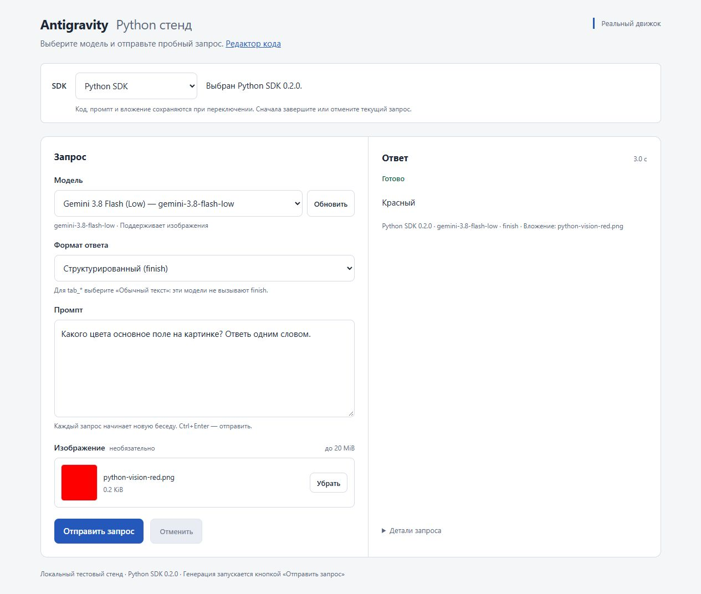
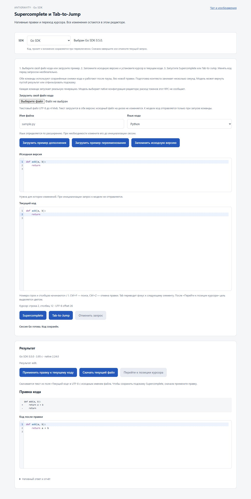
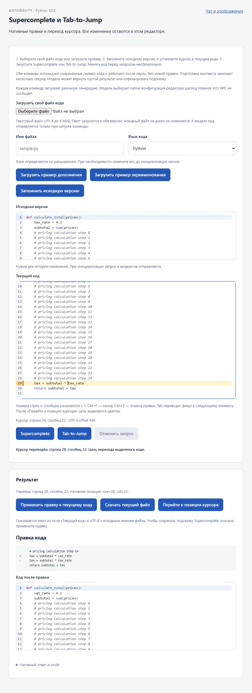

# Antigravity Engine SDK

**Python and Go clients for the installed native Antigravity engine — with one browser testbench for both.**

[Русский](README.ru.md) · [Documentation](docs/README.md) · [Releases](https://github.com/Lotargo/antigravity_engine_sdk/releases) · [Changelog](CHANGELOG.md) · [Python API](docs/PYTHON.md) · [Go API](go/README.md)

Use your existing Antigravity sign-in to run text, structured output, vision,
image generation and native editor commands. Each SDK starts and owns its native
`language_server` process and talks to it over local Connect JSON RPC.
The Antigravity desktop app and agy CLI do not need to be running.

[Article: Antigravity's Hidden Models](https://lotargo.github.io/blog/posts/antigravity-hidden-models.html)
explores older and helper models, custom pipelines, and Pro / Ultra subscription economics.

| Component | Version | Requirements |
| --- | --- | --- |
| Python SDK | **0.2.0** | Python 3.10+ and `jsonschema` |
| Go SDK | **0.5.0** | Go 1.23+ to build applications |
| Shared testbench | Included | Python + built Go backend, or the Windows bundle |
| Native engine | **2.24.0 verified** | Installed Antigravity and an existing sign-in |

## Try the shared testbench

Select **Python SDK** or **Go SDK** without changing pages. Compare the same
prompt, image or code; each result shows its SDK, version and duration.



From a source checkout on Windows:

```powershell
git clone https://github.com/Lotargo/antigravity_engine_sdk.git
cd antigravity_engine_sdk
python -m venv .venv
.\.venv\Scripts\python.exe -m pip install ".[dev]"
go -C go build -o testbench/bin/antigravity-testbench-shared.exe ./testbench
.\.venv\Scripts\python.exe python/testbench/server.py
```

Open [the editor](http://127.0.0.1:8773/editor) or [chat and vision](http://127.0.0.1:8773/).
Choose another port with `--listen 127.0.0.1:8774` when necessary.

For a ready-built Windows testbench, download the shared testbench ZIP from
the [Python release](https://github.com/Lotargo/antigravity_engine_sdk/releases/tag/v0.2.0).
It includes the Go backend and local UI assets; Go and Node.js are not needed.
Python and the installed native Antigravity engine are still required.

[Setup guide](docs/GETTING_STARTED.md) · [Testbench guide](docs/TESTBENCH.md)

## What is available

| Capability | Python | Go |
| --- | --- | --- |
| Fresh model catalog | `models()` | `Models()` |
| Text through native `finish` | `chat()` | `Chat()` |
| Object JSON Schema and vision | `generate()` + `Media` | `Generate()` + `Media` |
| Literal text without tools | `complete()` | `Complete()` |
| Native image generation | `generate_image()` | `GenerateImage()` |
| Independent Supercomplete | `EditorSession.supercomplete()` | `EditorSession.Supercomplete()` |
| Independent Tab-to-Jump | `EditorSession.tab_to_jump()` | `EditorSession.TabToJump()` |
| Cancellation, deadlines and progress | Yes | Yes |
| Native trajectory, usage and raw RPC | Yes | Yes |

`chat()` and `generate()` require a real native `finish` result.
`complete()` is a separate contract for literal planner text, including `tab_*`
preview models. There is no automatic format or model fallback.

## Python quick start

Install from the checkout with `python -m pip install .`, or download and install
the wheel from the [Python release](https://github.com/Lotargo/antigravity_engine_sdk/releases/tag/v0.2.0).
The package is distributed through GitHub Releases; these instructions do not
require a PyPI publication.

```python
from antigravity_engine_sdk import Client

with Client() as client:
    models = client.models()  # Catalog only; no generation.
    print([model.id for model in models])

    result = client.chat(
        "Explain a camera lens in two sentences.",
        model="gemini-3.8-flash-low",  # Select an exact ID from your catalog.
    )
    print(result.text)
    print(result.usage)
```

[Full Python API guide](docs/PYTHON.md) · [Runnable examples](examples/)

## Go quick start

```shell
go get github.com/Lotargo/antigravity_engine_sdk/go@v0.5.0
```

```go
package main

import (
    "context"
    "fmt"
    "log"

    ag "github.com/Lotargo/antigravity_engine_sdk/go"
)

func main() {
    client, err := ag.NewClient(ag.Config{})
    if err != nil { log.Fatal(err) }
    defer client.Close()

    result, err := client.Chat(context.Background(), ag.Request{
        Prompt: "Explain a camera lens in two sentences.",
        Model:  "gemini-3.8-flash-low",
    })
    if err != nil { log.Fatal(err) }
    text, err := result.Text()
    if err != nil { log.Fatal(err) }
    fmt.Println(text)
}
```

Go runs independently of Python. The nested module uses the Git tag
[`go/v0.5.0`](https://github.com/Lotargo/antigravity_engine_sdk/releases/tag/go%2Fv0.5.0).
Private repository access requires Git credentials and `GOPRIVATE`; see the
[setup guide](docs/GETTING_STARTED.md#private-repository-access).

[Full Go API guide](go/README.md) · [Standalone Go testbench](go/testbench/README.md)

## Native code editing

Load a UTF-8 code file, keep its baseline, place the cursor and run
**Supercomplete** or **Tab-to-Jump**. Both commands can be started manually after
a pause, without a new edit. Suggestions are previewed before application.

The editor includes syntax highlighting, line numbers, search, undo/redo,
visible jump targets and download of the current file under its original name.
Switching SDK preserves the code and cursor; sessions and last results are
separate for each SDK. Initialize the baseline once in each SDK.

<details>
<summary>Supercomplete: native diff and editable preview</summary>



</details>

<details>
<summary>Tab-to-Jump: native position and highlighted cursor target</summary>



</details>

## Compatibility and validation

The SDK uses an internal engine protocol and is an independent project, not an
official Google SDK. Native acceptance was performed on **Windows / Antigravity
2.24.0**. Linux/macOS discovery paths exist, but native operation on those
platforms has not been verified. Independent editor preparation is guarded for
the verified native version.

Model availability comes from your account's live catalog. Suggestions can be
empty, filtered or incorrect; review native edits before applying them.
Editor token usage and cancelled request usage remain **UNKNOWN** when the
native engine does not report them. Reported durations are observations, not
a performance ranking of SDKs or models.

The current local checks include **100 SDK/stand tests and 4 packaging tests**, the Go test suite and
live checks of both SDKs through the shared UI.
[Validation records](docs/README.md#validation-records) distinguish protocol
tests from real native calls.

## Project layout

```text
src/antigravity_engine_sdk/   Python package
go/                          Independent Go module and standalone testbench
python/testbench/            Shared Python / Go browser launcher
examples/                    Python examples and opt-in native probes
docs/                        Guides, screenshots and validation records
scripts/                     Release packaging
```

The native Antigravity executable, account credentials and user profile are not
distributed. No SDK license is selected for this release; third-party notices
are retained in [THIRD_PARTY.md](THIRD_PARTY.md).
